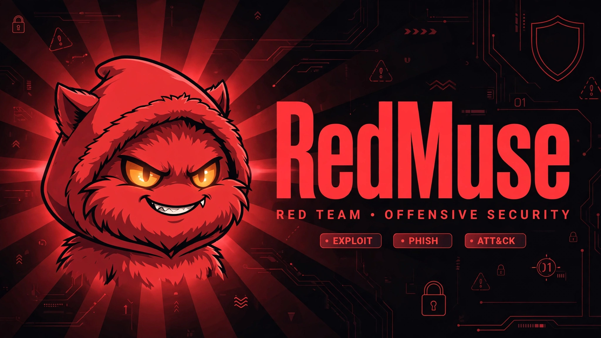
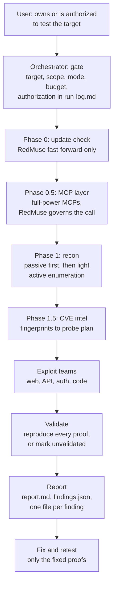

# RedMuse

**RedMuse - Autonomous pentesting, built for Muse.ai.**



[](LICENSE)
[](https://muse.ai)
[](docs/ARCHITECTURE.md)
[](docs/ARCHITECTURE.md)

Autonomous pentesting, built for Muse.ai, Meta's personal AI agent.
No Docker, no LLM key, no separate engine. Muse is the engine: an
orchestrator plus specialist agents run recon, exploitation,
proof-of-concept validation, fixing, and reporting against targets
you own or are authorized to test.

Inspired by the architecture of [Strix](https://github.com/usestrix/strix)
(agent graph, skill packs, sandbox runtime, SARIF-style reporting),
rebuilt from scratch as skills and playbooks that anyone with Muse.ai can
install and run. Skill content here is original writing. Strix itself
is Apache-2.0, and its methodology topics (OWASP Top 10, API Top 10,
IDOR, SSRF, and friends) are credited in [`docs/ARCHITECTURE.md`](docs/ARCHITECTURE.md).

## Quick start

### In Muse.ai: no terminal needed

You do not clone anything. Ask Muse to install the pack, and it
fetches the skills from the repo. Paste this, replacing the
target with your own:

```text
Install the RedMuse skill pack from https://github.com/reblox01/RedMuse
and run a quick scan of https://staging.example.com.
I own this target and authorize active testing on it.
Start with the authorization gate, then run the phases and write
the report.
```

Same install, other jobs:

```text
Install the RedMuse skill pack from https://github.com/reblox01/RedMuse
and run a dev-audit of my code against my localhost staging copy.
Code audit first, then a live proof for each finding, then fix
and retest.
```

```text
Install the RedMuse skill pack from https://github.com/reblox01/RedMuse
and fix the open findings in redmuse-runs/<run-name>/, one finding
at a time, retesting each original proof before closing it.
```

No active test runs without the gate: the orchestrator records
target, scope, and authorization first.

### On your own PC: terminal install

Only for local setups with a terminal and a workspace folder,
such as a local Muse or Claude Code install. This is not needed
for Muse.ai. It copies the 17 skills into your custom skills
folder so you can invoke them by name.

```bash
git clone https://github.com/reblox01/redmuse.git
cd redmuse
./scripts/install.sh
```

Then invoke [redmuse-orchestrator](skills/redmuse-orchestrator/SKILL.md) with the same target, scope,
and authorization as above.

## Releases

Tagged versions (v1.0.0, ...) ship a zip of the skill pack on
[the Releases page](https://github.com/reblox01/RedMuse/releases), built by [.github/workflows/release.yml](.github/workflows/release.yml). The
zip holds skills, docs, templates, tools, scripts, and examples.
The test targets are not in the zip; they stay in the repo for
demos only. To install a pinned version, ask Muse to install
that tag instead of main:

```text
Install the RedMuse skill pack version v1.0.0 from
https://github.com/reblox01/RedMuse.
```

The phase 0 update check tracks git HEAD, so a pinned install
stays pinned until you ask Muse to install a newer tag. CI runs
on every push to main ([.github/workflows/ci.yml](.github/workflows/ci.yml)): skill files
present, sources.yaml valid and covering every skill, report
renderer smoke test, and the update check as an informational
step. The release workflow runs when a v* tag exists, and tags
are automatic: [.github/workflows/auto-tag.yml](.github/workflows/auto-tag.yml) watches every
push to main except workflow, README, and LICENSE changes,
so any push that edits anything else creates the next patch
tag (first tag v0.1.0), which then triggers the release. Put
[release:minor] or [release:major] in a commit message to bump
more, or [skip-release] to skip a tag for a trivial edit.
Pushing a v* tag by hand still works.

## What is inside

17 skills, one per job:

- [redmuse-orchestrator](skills/redmuse-orchestrator/SKILL.md): the gate, the teams, the budgets, validation
- [redmuse-recon](skills/redmuse-recon/SKILL.md): attack surface inventory, passive first
- [redmuse-cve-intel](skills/redmuse-cve-intel/SKILL.md): CVE intel from fingerprints, before any exploit team
- [redmuse-web](skills/redmuse-web/SKILL.md): OWASP Top 10, black-box
- [redmuse-api](skills/redmuse-api/SKILL.md): OWASP API Security Top 10
- [redmuse-auth](skills/redmuse-auth/SKILL.md): login, session, JWT, privilege boundaries
- [redmuse-code](skills/redmuse-code/SKILL.md): white-box data-flow review
- [redmuse-report](skills/redmuse-report/SKILL.md): severity, dedupe, honest coverage, retest
- [redmuse-verify](skills/redmuse-verify/SKILL.md): independent verifier, re-runs each proof unchanged before reporting, verdicts verified, candidate, rejected, or blocked, with a replayable proof capsule
- [redmuse-bizlogic](skills/redmuse-bizlogic/SKILL.md): business logic testing, price, payment, workflow order, limits, roles, and state, broken with the app's own features
- [redmuse-exploit](skills/redmuse-exploit/SKILL.md): exploit chaining and deep exploitation, injection, SSRF, auth bypass, race conditions, file upload, filter bypass, harmless markers only, localhost or staging
- [redmuse-ui](skills/redmuse-ui/SKILL.md): UI, UX and SEO audit, desktop and mobile screenshots, annotated visual proof
- [redmuse-fix](skills/redmuse-fix/SKILL.md): root cause patch plus retest loop
- [redmuse-ci](skills/redmuse-ci/SKILL.md): diff-scoped merge gate for GitHub Actions
- [redmuse-dev-audit](skills/redmuse-dev-audit/SKILL.md): dev audit, code chained to live proof on dev and staging
- [redmuse-update](skills/redmuse-update/SKILL.md): pre-run update check, auto-pull for RedMuse itself, flags for reference sources
- [redmuse-mcp](skills/redmuse-mcp/SKILL.md): optional MCP layer, set up in phase 0.5. MCPs stay full power, RedMuse governs the call, no-key tools first, keyed tools with a step-by-step walkthrough, declined or unavailable means not run, never clean

Plus:

- [`docs/RESEARCH.md`](docs/RESEARCH.md): Strix deep dive, scan modes, field landscape,
  what makes a security tool spread
- [`docs/ARCHITECTURE.md`](docs/ARCHITECTURE.md): Strix-to-Muse mapping, scan modes, team
  protocols, tool tiers, report schema, sandbox modes
- [`docs/MCPs.md`](docs/MCPs.md): optional MCP layer, full-power MCPs governed by RedMuse
- [`docs/SAFETY.md`](docs/SAFETY.md): the authorization gate and the rules that are part
  of the tool
- [`templates/`](templates/): finding, report, and run log templates
- [`tools/render_report.py`](tools/render_report.py): findings.json to standalone HTML report
- [`tools/cve_lookup.py`](tools/cve_lookup.py): fingerprint list to CVE shortlist, OSV for
  packages, NVD candidates for runtimes, standard library only
- [`test-target/`](test-target/) and [`test-target-api/`](test-target-api/): intentionally vulnerable
  localhost apps, fake data only, never deploy them publicly
- [`examples/`](examples/): real sample reports from localhost runs, plus a worked MCP setup record

## Architecture

Muse is the engine. There is no Docker container, no LLM key, and
no separate scanner binary to install. An orchestrator plus
specialist subagents run the phases, and every phase writes to
one run folder. Full detail lives in
[docs/ARCHITECTURE.md](docs/ARCHITECTURE.md), and the background
research behind it lives in [docs/RESEARCH.md](docs/RESEARCH.md).



How the pieces fit:

- **Orchestrator, not a single agent.** It owns the gate, the
  budgets, and the final severity call. It never does every phase
  itself in one long pass, and a subagent claim is not a finding
  until the orchestrator reproduces the proof or marks it
  unvalidated.
- **Phases feed each other, in order.** Recon builds the attack
  surface, CVE intel turns fingerprints into a probe plan, exploit
  teams only work their class list plus that plan, and validation
  decides what survives into the report.
- **MCPs and ensemble skills are layers, not separate scans.**
  MCP results and overlapping skills feed recon, CVE intel, and
  the coverage matrix, and a layer that did not run is recorded
  as not run, never as clean.
- **The workspace is the sandbox.** That is the honest limit:
  isolation is weaker than a fresh container per target, which
  is why payloads stay non-destructive and test accounts only.
- **Output is always the same shape.** A run folder holds the
  run log, the ranked report, the machine-readable findings, and
  one file per confirmed finding, so a fix and retest can target
  exactly the proofs that were open.

## Scan modes

| Mode | Meaning | Probes | Time | Teams |
|---|---|---|---|---|
| quick | Breadth, high-impact targets first | 50 | 30 min | 3 |
| standard | Full recon, business logic, methodical testing | 150 | 2 h | 3 |
| deep | Every parameter and edge case, chained findings | 300 | 4 h | 5 |
| diff | Changed code only, for pull requests | 100 | 1 h | 2 |

## Dev-audit mode

For your own code in dev: code audit chained to live exploit proofs on localhost or staging, plus a Cloudflare edge checklist and Securly AI and agent layers when the target is an AI app. Dev does not waive the gate: target, scope, and authorization are still recorded first. See [`skills/redmuse-dev-audit/SKILL.md`](skills/redmuse-dev-audit/SKILL.md) and [`examples/sample-dev-audit.md`](examples/sample-dev-audit.md).

## CVE intel

Phase 1.5, after recon, before any exploit team: fingerprint the
versions actually running, query live CVE data, and build a probe
plan from the shortlist. Patched versions get no probe,
unknown versions get no exploit attempt, and remote code execution
gets version evidence only on live targets. See
[`skills/redmuse-cve-intel/SKILL.md`](skills/redmuse-cve-intel/SKILL.md) and
[`examples/sample-cve-intel.md`](examples/sample-cve-intel.md).

## MCP layer

Optional tools, governed by RedMuse, never limited at the MCP
itself. The MCP is a toolbelt: it stays full power, and RedMuse
picks which tool, when, on what target, and with what input. The
same MCP is called passively on production and actively on
localhost or staging, because the target changed, not the tool.

Phase 0.5, after the update check and before recon, offers MCPs
one at a time. No-key tools first, keyed tools second with a
per-tool ask plus a step-by-step walkthrough to get the key on
the official site, and a key is never pasted in chat, in a log,
or in a report. A declined or unavailable MCP is recorded as not
run, never clean, and RedMuse works with zero MCPs.

Starter set, and what each one feeds:

| MCP | Needs | Feeds |
|---|---|---|
| SniffPup, passive scan | Site confirmation, per site, hosted, no key | Recon |
| Context7, docs lookup | Hosted connection | Recon, code |
| next-devtools, dev-server inspection | Running Next.js 16+ dev server, local, no key | Dev-audit, code |
| cybersecurity MCP, NVD lookup | Nothing, NVD is free, local, no key | CVE intel |

Every offer states hosted or local, because local MCPs do not work
from a Muse.ai session, only on the user's own machine. See
[`skills/redmuse-mcp/SKILL.md`](skills/redmuse-mcp/SKILL.md), [`docs/MCPs.md`](docs/MCPs.md), and the worked
setup in [`examples/sample-mcp-setup.md`](examples/sample-mcp-setup.md).

## Staying current

Every run starts with a phase 0 update check ([redmuse-update](skills/redmuse-update/SKILL.md), script
[tools/check_updates.py](tools/check_updates.py), sources in [skills/redmuse-update/sources.yaml](skills/redmuse-update/sources.yaml)).
RedMuse itself auto-pulls on a fast-forward
only, before any target work. Strix, Securly, Cloudflare, Sentry, OWASP, Masriyan, Trail of Bits,
OpenAI, ClawSec, Varlock, REA, and SquirrelScan are reference sources, not vendored code, so their changes
are flagged
as follow-up tasks instead of silently rewriting skill content.
Nothing updates mid-run and nothing pushes automatically. Sources
and their check rules live in [docs/SOURCES.md](docs/SOURCES.md).

## Ensemble scoring

RedMuse runs overlapping skills on the same surface on purpose, so
if one skill misses something, another may find it. Candidate
records that share a finding merge into one, with a confirmed_by
list and a confidence score from evidence: live proof, traced code
path, and extra confirming skills, total 0 to 5, banded as
corroborated, confirmed, weak, or unvalidated. The report also
carries a coverage matrix, flags single-coverage classes, and
lists unprobed classes as gaps, never as clean. See
[examples/sample-ensemble.md](examples/sample-ensemble.md).

## Proven on localhost

Web test target, quick run: 2 high (IDOR, API BOLA), 1 medium
(reflected XSS), 1 low (open redirect), 1 info (missing headers). All
reproduced live. See [`examples/sample-report-localhost.md`](examples/sample-report-localhost.md).

API test target, quick run: 2 high (BOLA, mass assignment), 2 medium
(admin bypass, excessive data exposure). All reproduced live. See
[`examples/sample-report-api.md`](examples/sample-report-api.md).

Dev-audit demo: code location plus live proof for the web target IDOR, XSS, and redirect flaws. See [`examples/sample-dev-audit.md`](examples/sample-dev-audit.md).

## Proven live (anonymized)

Same engine, real authorized targets, 3 Nov 2026: 3 live sites in quick
mode plus 2 codebases in dev-audit mode. Targets are anonymized, no
domains or repo names are listed. Totals: 0 critical, 2 high, 4 medium,
8 low, 14 info across the 5 runs, plus one major question left honestly
unvalidated (a PHP runtime version question that could not be answered
from outside and was not exploited). See
[`examples/live-runs-anonymized.md`](examples/live-runs-anonymized.md) for the per-run tables, what was
found, what was checked clean, and what was left as gaps.

## How it compares

| | redmuse | Strix CLI | Strix Cloud | ZAP / Nuclei |
|---|---|---|---|---|
| Engine | Muse.ai itself | Any LLM via key | Hosted | Signatures |
| Infra needed | None | Docker | None | Local binary |
| Cost | Free | LLM key cost | Credits | Free |
| Findings | Proved with PoC | Proved with PoC | Proved with PoC | Alerts, often unproved |
| Sandbox | Workspace | Fresh container | Hosted | None |
| Best for | Muse.ai users, fast | Full local control | Teams, schedules | Quick signature scans |

Honest limits: the workspace is the sandbox, not a fresh container per
target, and one brain with subagent teams is less parallel than a true
model swarm. Coverage statements in every report say exactly what was
and was not probed.

## Safety

Read [`docs/SAFETY.md`](docs/SAFETY.md) before your first run. The short version: only
test targets you own or are authorized to test, passive first, active
probes only after the authorization gate, non-destructive payloads
only, test accounts only, secrets masked in every report.

## Roadmap

- SARIF export from findings.json for GitHub code scanning
- Container mode for untrusted targets when Docker is available
- Scheduled runs and webhook results
- A benchmark target suite with a public scoreboard per release

## Contributing

See [`CONTRIBUTING.md`](CONTRIBUTING.md). One skill per pull request, tested against the
localhost targets, no live targets in tests.

## License

MIT. See [`LICENSE`](LICENSE).
